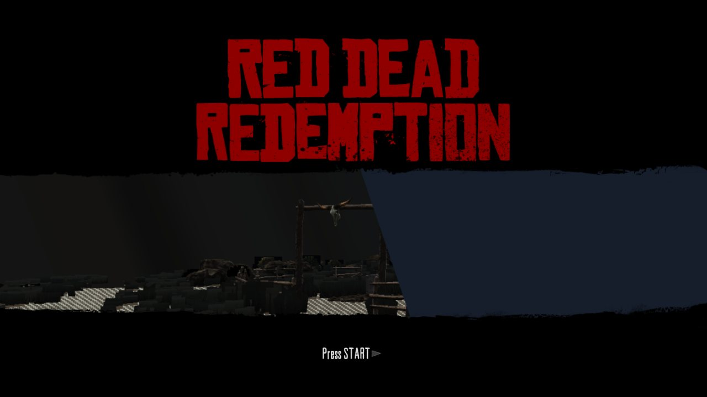
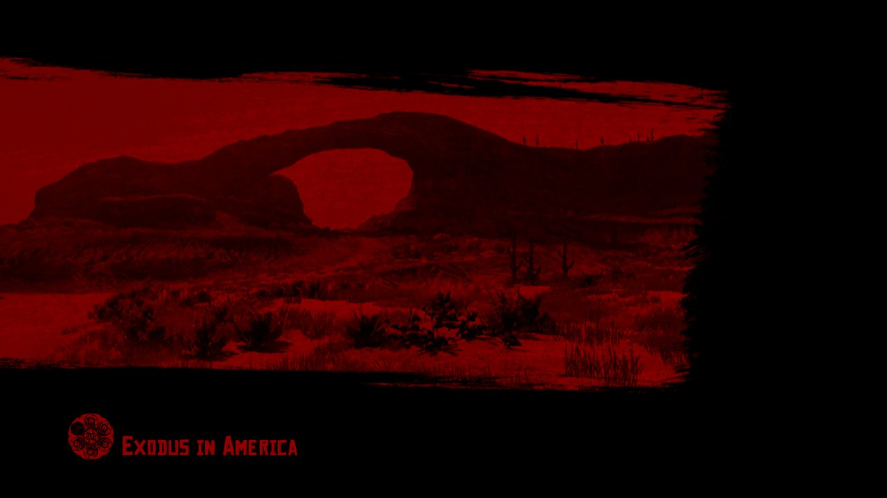
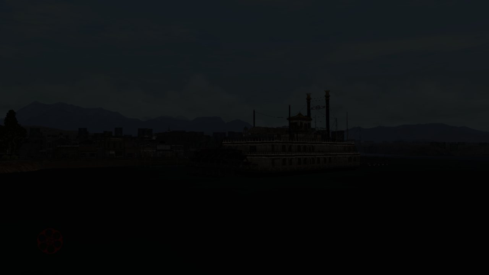
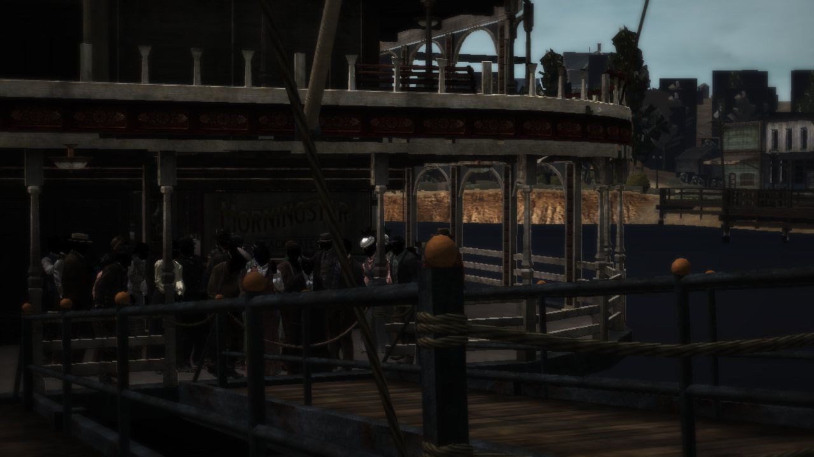

# Red Dead Redemption — Recompiled (PS3 → PC)

*[English below](#english)*

Recompilação estática **pessoal e experimental** de *Red Dead Redemption — Game of the Year Edition* (PS3, EUA; diretório de dados `BLUS30418`) para Windows x64, construída sobre o toolkit [ps3recomp](https://github.com/sp00nznet/ps3recomp).

> **Este repositório não contém o jogo.** Não há aqui executável, ELF, código traduzido do jogo, programas SPU, firmware, chaves, dados do disco, quadros crus nem logs (só as quatro capturas abaixo, da saída do port). Para compilar é preciso ter a sua própria cópia do jogo e produzir localmente os arquivos de entrada. Ver [docs/LEGAL.md](docs/LEGAL.md).

## Estado

> **Pesquisa, longe de ser jogável.** O jogo inicia, passa pelos menus e chega à **primeira cutscene 3D** (cerca de 2 minutos depois do boot), que roda a **4–6 FPS**. A tela título roda a 5–7 FPS.
>
> - **Áudio:** funcionando: música, ambiente e os vídeos da abertura (sete correções do runtime, a maioria genérica; ver [docs/STATUS.md](docs/STATUS.md)).
> - **Desempenho:** limitado pela CPU. Um experimento com o PR sp00nznet/ps3recomp#632 (float do SPU nativo) levou a tela título a 29–44 FPS; ainda não está no build.
> - **Imagem:** a cena é desenhada com defeitos (cintilação, elementos sumindo, trechos escuros). O backend Vulkan do toolkit já compila no Windows, mas no RDR ainda desenha bem pior que o Direct3D 12.
> - **Entrada:** só XInput; a navegação até a cena é feita por roteiro de botões (`PAD_SCRIPT`).
> - **Estabilidade:** o PC hospedeiro já congelou em boots longos; por isso o jogo só deve rodar por `scripts\boot_seguro.ps1`.
>
> Detalhes, números e próximos passos: [docs/STATUS.md](docs/STATUS.md).

## O que tem aqui

| Caminho | Conteúdo |
| :--- | :--- |
| `port/` | Projeto CMake do executável (derivado do `templates/project` do ps3recomp), `main.cpp`, `stubs.cpp`, `src/fs_area.c` e `src/audio_float/` |
| `patches/` | Mudanças no ps3recomp: `ps3recomp-v0.19.0-upstream-prs.patch` (12 PRs abertos do toolkit), `ps3recomp-v0.19.0-rdr.patch` (runtime e bibliotecas HLE) e `ps3recomp-v0.18.0-ppu_lifter.patch` (tabelas de salto do lifter) |
| `scripts/` | Preparação, build, boot protegido e atalhos (PowerShell), com caminhos relativos a `RDR_ROOT` |
| `launcher/` | Janela tkinter: confere a instalação, roda e para o jogo sempre pelo boot protegido |
| `analysis/` | Ferramentas de diagnóstico e análise, experimentos e scripts históricos das tentativas |
| `spu/` | `images.json`: identificadores (hash, tamanho) dos programas SPU, jobs e plugins DSP traduzidos — sem código |
| `docs/` | [BUILDING](docs/BUILDING.md), [STATUS](docs/STATUS.md), [DEBUGGING](docs/DEBUGGING.md), [RELATED_PROJECTS](docs/RELATED_PROJECTS.md), [LEGAL](docs/LEGAL.md); visão geral em [ARCHITECTURE.md](ARCHITECTURE.md) |
| `.github/workflows/` | CI `no-game-files`: falha se algo do jogo for rastreado ou se um arquivo passar de 2 MB |
| `local/` | **Ignorada pelo git.** ELF, lift, SPU traduzido, VFS, build, logs — tudo que vem do jogo |

## Capturas

Saída do próprio port (`LD_FRAME_DUMP`, 1280×720), boot `seg182` de 2026-11-08 (cópias NV0039 ligadas, hoje no build), sem retoque.

| | |
| :---: | :---: |
|  |  |
| Tela título (~8 FPS) | Carga da primeira missão |
|  |  |
| Primeira cutscene: barco ao longe (~6 FPS) | O plano seguinte, no cais: escuro e com defeitos |

## Início rápido

1. Tenha a sua cópia do jogo e gere você mesmo o ELF decriptado e a árvore de dados (este repositório não explica nem automatiza isso).
2. Clone o ps3recomp na tag `v0.19.0` em `local\ps3recomp` e rode `scripts\prepare_toolkit.ps1` (aplica os 12 PRs em `local\ps3recomp-rdr`).
3. Traduza o ELF com o `ppu_lifter.py` da v0.18.0 mais `patches/ps3recomp-v0.18.0-ppu_lifter.patch`; para ter música, traduza também o `flashMP3.pic` do seu firmware com `analysis\tools\lift_mp3.py`.
4. `scripts\prepare_overlay.ps1` → aplica o patch do RDR em cópias, em `local\overlay`.
5. `scripts\build.ps1` → `local\build\MyGameRecomp.exe`.
6. `scripts\boot_seguro.ps1 -Tag teste -Segundos 330`, ou o launcher: `scripts\launch.ps1`.

Passo a passo completo em [docs/BUILDING.md](docs/BUILDING.md).

## Créditos

- **[ps3recomp](https://github.com/sp00nznet/ps3recomp)** — Ned Heller / sp00nznet e colaboradores, licença MIT. Todo o runtime, as bibliotecas HLE, o lifter PPU/SPU e o template do projeto são deles; este port só adiciona patches e scripts. O texto da licença está em [LICENSES/ps3recomp-MIT.txt](LICENSES/ps3recomp-MIT.txt).
- PRs abertos do ps3recomp usados na base: sp00nznet/ps3recomp#746, sp00nznet/ps3recomp#754, sp00nznet/ps3recomp#702, sp00nznet/ps3recomp#736, sp00nznet/ps3recomp#738 (Vulkan), sp00nznet/ps3recomp#764, sp00nznet/ps3recomp#713, sp00nznet/ps3recomp#759, sp00nznet/ps3recomp#758, sp00nznet/ps3recomp#760, sp00nznet/ps3recomp#761, sp00nznet/ps3recomp#601 (estabilidade), mais sp00nznet/ps3recomp#701, sp00nznet/ps3recomp#665 e sp00nznet/ps3recomp#662 (render) dentro do patch do RDR. Correções deste port enviadas ao toolkit: sp00nznet/ps3recomp#712, sp00nznet/ps3recomp#714 e sp00nznet/ps3recomp#715.
- Estrutura do repositório inspirada em [God of War Ascension Recompiled](https://github.com/MaChInEgUn3/God-of-War-Ascension-Recompiled).
- **Assistência de IA:** grande parte do código, dos scripts e desta documentação foi escrita com assistentes de IA (Claude Code, da Anthropic, e Google Antigravity), sob orientação e revisão do autor. Os testes de boot foram feitos na máquina do autor.

## Licença

O código e a documentação próprios deste repositório estão sob a licença MIT ([LICENSE](LICENSE)). Os patches modificam arquivos do ps3recomp, que continuam sob a licença MIT deles. Nada do jogo, do firmware ou derivado deles está coberto por esta licença, e nada disso pode ser enviado ao repositório.

*Red Dead Redemption* é marca da Take-Two Interactive / Rockstar Games. Este é um projeto de pesquisa de fã, sem afiliação nem endosso da Take-Two, da Rockstar ou da Sony. PlayStation é marca da Sony Interactive Entertainment.

---

## English

A **personal, experimental** static recompilation of *Red Dead Redemption — Game of the Year Edition* (PS3, US; data directory `BLUS30418`) to Windows x64, built on the [ps3recomp](https://github.com/sp00nznet/ps3recomp) toolkit.

> **This repository does not contain the game.** No executable, ELF, lifted game code, SPU programs, firmware, keys, disc data, raw frames or logs (only the four screenshots of the port's output shown here). You need your own copy of the game and must produce the inputs locally. See [docs/LEGAL.md](docs/LEGAL.md).

### Status

> **Research, far from playable.** The game boots, goes through the menus and reaches the **first 3D cutscene** (about 2 minutes after boot), which runs at **4–6 FPS**. The title screen runs at 5–7 FPS.
>
> - **Audio:** working: music, ambience and the intro videos (seven runtime fixes, most of them generic; see [docs/STATUS.md](docs/STATUS.md)).
> - **Performance:** CPU-bound. An experiment with PR sp00nznet/ps3recomp#632 (native SPU float) took the title screen to 29–44 FPS; it is not in the build yet.
> - **Picture:** the scene renders with defects (flicker, disappearing elements, dark areas). The toolkit's Vulkan backend now builds on Windows, but on RDR it still draws far worse than Direct3D 12.
> - **Input:** XInput only; menus are driven by a scripted button sequence (`PAD_SCRIPT`).
> - **Stability:** the host PC has frozen during long boots, so only run the game through `scripts\boot_seguro.ps1`.
>
> Details and next steps: [docs/STATUS.md](docs/STATUS.md) (Portuguese, with an English summary).

### What lives here

| Path | Contents |
| :--- | :--- |
| `port/` | CMake project for the executable (derived from ps3recomp's `templates/project`), `main.cpp`, `stubs.cpp`, `src/fs_area.c`, `src/audio_float/` |
| `patches/` | Changes to ps3recomp: `ps3recomp-v0.19.0-upstream-prs.patch` (12 open toolkit PRs), `ps3recomp-v0.19.0-rdr.patch` (runtime and HLE libraries) and `ps3recomp-v0.18.0-ppu_lifter.patch` (lifter jump tables) |
| `scripts/` | Prepare, build, guarded boot and shortcuts (PowerShell), paths relative to `RDR_ROOT` |
| `launcher/` | tkinter window: checks the setup, starts and stops the game, always through the guarded boot |
| `analysis/` | Diagnostic and analysis tools, experiments, historical per-attempt scripts |
| `spu/` | `images.json`: identifiers (hash, size) of the lifted SPU programs, jobs and DSP plugins — no code |
| `docs/` | [BUILDING](docs/BUILDING.md), [STATUS](docs/STATUS.md), [DEBUGGING](docs/DEBUGGING.md), [RELATED_PROJECTS](docs/RELATED_PROJECTS.md), [LEGAL](docs/LEGAL.md); overview in [ARCHITECTURE.md](ARCHITECTURE.md) |
| `.github/workflows/` | `no-game-files` CI: fails if anything from the game is tracked or a file exceeds 2 MB |
| `local/` | **Git-ignored.** ELF, lift, lifted SPU code, VFS, build, logs — everything derived from the game |

### Screenshots

The port's own output (`LD_FRAME_DUMP`, 1280×720), boot `seg182` from 2026-11-08 (NV0039 copies on, now in the build), untouched: title screen (~8 FPS), first-mission loading screen, and the first cutscene — the boat in the distance (~6 FPS), then the next shot on the dock, dark and with rendering defects. Images are in the table above.

### Quick start

1. Own the game and produce the decrypted ELF and the data tree yourself (this repository neither explains nor automates that).
2. Clone ps3recomp at tag `v0.19.0` into `local\ps3recomp` and run `scripts\prepare_toolkit.ps1` (applies the 12 PRs into `local\ps3recomp-rdr`).
3. Lift the ELF with ps3recomp v0.18.0's `ppu_lifter.py` plus `patches/ps3recomp-v0.18.0-ppu_lifter.patch`; for music, also lift your own firmware's `flashMP3.pic` with `analysis\tools\lift_mp3.py`.
4. `scripts\prepare_overlay.ps1` applies the RDR patch to copies in `local\overlay`.
5. `scripts\build.ps1` → `local\build\MyGameRecomp.exe`.
6. `scripts\boot_seguro.ps1 -Tag test -Segundos 330`, or the launcher: `scripts\launch.ps1`.

Full steps in [docs/BUILDING.md](docs/BUILDING.md).

### Credits

- **[ps3recomp](https://github.com/sp00nznet/ps3recomp)** by Ned Heller / sp00nznet and contributors, MIT. The runtime, HLE libraries, PPU/SPU lifters and project template are theirs; this port adds patches and scripts. Licence text: [LICENSES/ps3recomp-MIT.txt](LICENSES/ps3recomp-MIT.txt).
- Open ps3recomp PRs in the base: sp00nznet/ps3recomp#746, sp00nznet/ps3recomp#754, sp00nznet/ps3recomp#702, sp00nznet/ps3recomp#736, sp00nznet/ps3recomp#738 (Vulkan), sp00nznet/ps3recomp#764, sp00nznet/ps3recomp#713, sp00nznet/ps3recomp#759, sp00nznet/ps3recomp#758, sp00nznet/ps3recomp#760, sp00nznet/ps3recomp#761, sp00nznet/ps3recomp#601 (stability), plus sp00nznet/ps3recomp#701, sp00nznet/ps3recomp#665 and sp00nznet/ps3recomp#662 (rendering) inside the RDR patch. Fixes from this port sent upstream: sp00nznet/ps3recomp#712, sp00nznet/ps3recomp#714, sp00nznet/ps3recomp#715.
- Repository layout modelled on [God of War Ascension Recompiled](https://github.com/MaChInEgUn3/God-of-War-Ascension-Recompiled).
- **AI assistance:** much of the code, scripts and documentation was written with AI assistants (Anthropic's Claude Code and Google Antigravity), directed and reviewed by the author. Boot tests ran on the author's machine.

### License

This repository's own code and documentation are MIT ([LICENSE](LICENSE)). The patches modify ps3recomp files, which remain under ps3recomp's MIT licence. Nothing from the game or firmware, or derived from them, is covered by this licence or may be committed.

*Red Dead Redemption* is a trademark of Take-Two Interactive / Rockstar Games. This is fan research, not affiliated with or endorsed by Take-Two, Rockstar or Sony. PlayStation is a trademark of Sony Interactive Entertainment.
